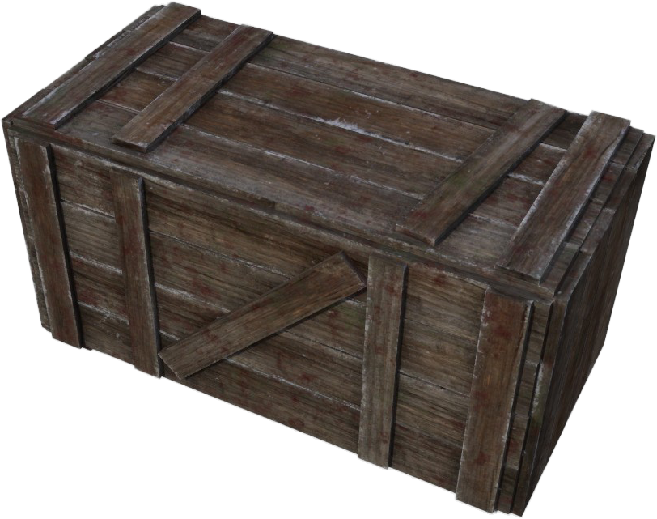

# AKA

Unreal Engine 5.6으로 만든 탑뷰 보스 러시 액션 게임 **AKA**의 게임 코드입니다.

쓰러뜨릴 때마다 더 강해져 돌아오는 보스와 싸우며 클리어 시간을 기록합니다.

- 영상과 구현 설명: https://juni4268.github.io/aka/
- 플레이 빌드 (Windows): [Releases](https://github.com/juni4268/AKA-Portfolio/releases/latest)
- 이 저장소는 포트폴리오용으로 **코드와 설정만** 공개합니다. 캐릭터, 맵, 사운드, 이펙트는 마켓플레이스(Fab) 에셋이라 포함하지 않았고, 이 저장소만으로는 에디터에서 프로젝트를 열 수 없습니다.

## 개요

| | |
|---|---|
| 엔진 | Unreal Engine 5.6 · C++ |
| 시점 | 탑뷰 |
| 기간 | 2025년 8월~11월 (4개월) |
| 인원 | 1인 제작 |
| 담당 | 기획, 프로그래밍, UI 제작 |

## 주요 구현 코드

소개 페이지에서 설명하는 부분입니다.

| 내용 | 코드 |
|---|---|
| 보스 AI: 거리·페이즈·기절·대기 시간을 0.1초마다 갱신하는 서비스 노드 | [`BTService_UpdateBossState.cpp`](Source/AKA/BTService_UpdateBossState.cpp) |
| 보스 패턴과 페이즈: 페이즈 전환, 점프 공격의 순서 | [`BossMonster.cpp`](Source/AKA/BossMonster.cpp) |
| 돌진과 기둥: 돌진 중 충돌과 기절 | [`BossMonster.cpp`](Source/AKA/BossMonster.cpp) |
| 돌진과 기둥: 부딪힌 횟수에 따라 쓰러지는 기둥 | [`StunnablePillar.cpp`](Source/AKA/StunnablePillar.cpp) |
| 강해지는 보스: 레벨에 따른 수치 | [`BossMonster.cpp`](Source/AKA/BossMonster.cpp) |
| 랩타임 기록 | [`AKAGameInstance.cpp`](Source/AKA/AKAGameInstance.cpp) |

## 보스 공격 노드

비헤이비어 트리에서 공격 하나가 노드 하나입니다.

| 공격 | 코드 |
|---|---|
| 근접 공격 | [`BTTaskNode_Attack`](Source/AKA/BTTaskNode_Attack.cpp), [`BTTaskNode_Attack_P2`](Source/AKA/BTTaskNode_Attack_P2.cpp) |
| 돌진 | [`BTTaskNode_DashAttack`](Source/AKA/BTTaskNode_DashAttack.cpp) |
| 점프 공격 | [`BTTaskNode_JumpAttack`](Source/AKA/BTTaskNode_JumpAttack.cpp), [`BTTaskNode_JumpAttack_P2`](Source/AKA/BTTaskNode_JumpAttack_P2.cpp) |
| 원거리 공격 | [`BTTaskNode_RangeAttack`](Source/AKA/BTTaskNode_RangeAttack.cpp) |

## 그 외 코드

| 내용 | 위치 |
|---|---|
| AI 컨트롤러 | [`BossAIController.cpp`](Source/AKA/BossAIController.cpp) |
| 시야 확인 조건 노드 | [`BTDecorator_CheckLineOfSight.cpp`](Source/AKA/BTDecorator_CheckLineOfSight.cpp) |
| 점프 공격의 바닥 표시 | [`JumpAttackIndicator.cpp`](Source/AKA/JumpAttackIndicator.cpp) |
| 번개 투사체(플레이어, 보스) | [`LightningBolt.cpp`](Source/AKA/LightningBolt.cpp), [`BossLightningBolt.cpp`](Source/AKA/BossLightningBolt.cpp) |
| 플레이어 | [`AkaPlayer.cpp`](Source/AKA/AkaPlayer.cpp) |
| 부서지는 엄폐물 | [`CoverActor.cpp`](Source/AKA/CoverActor.cpp) |
| 구역 전환(카메라, HUD, 랩타임 보드) | [`AKATrigger.cpp`](Source/AKA/AKATrigger.cpp) |
| UI | [`PlayerWidget.cpp`](Source/AKA/PlayerWidget.cpp), [`TitleWidget.cpp`](Source/AKA/TitleWidget.cpp) |

## 폴더

- `Source/AKA` — 게임 코드
- `Config` — 프로젝트 설정
- `AKA.uproject` — 엔진 버전과 플러그인(PaperZD)
