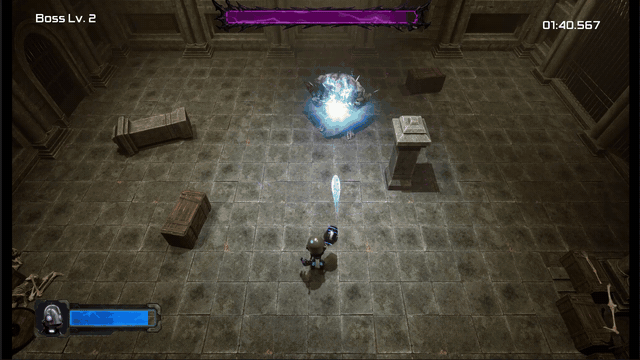

# AKA

쓰러뜨릴 때마다 더 강해져 돌아오는 보스와 싸우며 클리어 시간을 기록하는 탑뷰 보스 러시 액션 게임입니다.

- 영상과 구현 설명: https://juni4268.github.io/aka/
- 플레이 빌드 (Windows): [Releases](https://github.com/juni4268/AKA-Portfolio/releases/latest)

## 개요

| | |
|---|---|
| 엔진 | Unreal Engine 5.6 · C++ |
| 시점 | 탑뷰 |
| 기간 | 2025년 8월~11월 (4개월) |
| 인원 | 1인 제작 |
| 담당 | 기획, 프로그래밍, UI 제작 |

## 구현 내용

소개 페이지에서 영상과 함께 설명하는 부분입니다.

**비헤이비어 트리로 만든 보스 AI**
근접 공격, 돌진, 점프 공격, 원거리 공격을 각각 하나의 노드로 나누고, 트리가 상황에 맞는 공격을 고릅니다. 판단에 필요한 값(플레이어와의 거리, 페이즈, 기절 여부, 대기 시간)은 서비스 노드가 0.1초마다 갱신합니다.
→ [`BTService_UpdateBossState.cpp`](Source/AKA/BTService_UpdateBossState.cpp)

**보스 패턴과 세 페이즈**
체력이 3분의 2, 3분의 1 아래로 내려갈 때마다 페이즈가 바뀌어 세 단계로 진행됩니다.
→ [`BossMonster.cpp`](Source/AKA/BossMonster.cpp)

**돌진과 기둥**
돌진하는 보스를 기둥으로 유도해 부딪히게 하면 보스가 기절합니다. 기둥은 정해진 횟수만큼 부딪히면 쓰러지고, 쓰러진 기둥은 더 이상 보스를 기절시키지 않습니다.
→ [`BossMonster.cpp`](Source/AKA/BossMonster.cpp), [`StunnablePillar.cpp`](Source/AKA/StunnablePillar.cpp)

**강해지는 보스와 랩타임**
보스를 쓰러뜨리면 레벨이 올라 다시 등장하고, 체력, 공격별 피해량, 번개의 속도가 함께 올라갑니다. 보스 하나를 쓰러뜨리는 데 걸린 시간을 랩타임으로 기록합니다.
→ [`BossMonster.cpp`](Source/AKA/BossMonster.cpp), [`AKAGameInstance.cpp`](Source/AKA/AKAGameInstance.cpp)

## 조작

| 동작 | 키 |
|---|---|
| 이동 | W A S D |
| 공격 | 방향키 |
| 일시정지 | Esc |

## 그 외 코드

보스 공격 노드

| 공격 | 코드 |
|---|---|
| 근접 공격 | [`BTTaskNode_Attack`](Source/AKA/BTTaskNode_Attack.cpp), [`BTTaskNode_Attack_P2`](Source/AKA/BTTaskNode_Attack_P2.cpp) |
| 돌진 | [`BTTaskNode_DashAttack`](Source/AKA/BTTaskNode_DashAttack.cpp) |
| 점프 공격 | [`BTTaskNode_JumpAttack`](Source/AKA/BTTaskNode_JumpAttack.cpp), [`BTTaskNode_JumpAttack_P2`](Source/AKA/BTTaskNode_JumpAttack_P2.cpp) |
| 원거리 공격 | [`BTTaskNode_RangeAttack`](Source/AKA/BTTaskNode_RangeAttack.cpp) |

플레이어, 맵, UI

| 내용 | 위치 |
|---|---|
| AI 컨트롤러 | [`BossAIController.cpp`](Source/AKA/BossAIController.cpp) |
| 시야 확인 조건 노드 | [`BTDecorator_CheckLineOfSight.cpp`](Source/AKA/BTDecorator_CheckLineOfSight.cpp) |
| 점프 공격의 바닥 표시 | [`JumpAttackIndicator.cpp`](Source/AKA/JumpAttackIndicator.cpp) |
| 번개 투사체(플레이어, 보스) | [`LightningBolt.cpp`](Source/AKA/LightningBolt.cpp), [`BossLightningBolt.cpp`](Source/AKA/BossLightningBolt.cpp) |
| 플레이어 | [`AkaPlayer.cpp`](Source/AKA/AkaPlayer.cpp) |
| 부서지는 엄폐물 | [`CoverActor.cpp`](Source/AKA/CoverActor.cpp) |
| 구역 전환(카메라, HUD, 랩타임 보드) | [`AKATrigger.cpp`](Source/AKA/AKATrigger.cpp) |
| UI | [`PlayerWidget.cpp`](Source/AKA/PlayerWidget.cpp), [`TitleWidget.cpp`](Source/AKA/TitleWidget.cpp) |

## 이 저장소에 대해

포트폴리오용으로 **코드와 설정만** 공개합니다. 캐릭터, 맵, 사운드, 이펙트는 마켓플레이스(Fab) 에셋이라 포함하지 않았고, 이 저장소만으로는 에디터에서 프로젝트를 열 수 없습니다.

- `Source/AKA` — 게임 코드
- `Config` — 프로젝트 설정
- `AKA.uproject` — 엔진 버전과 플러그인(PaperZD)
